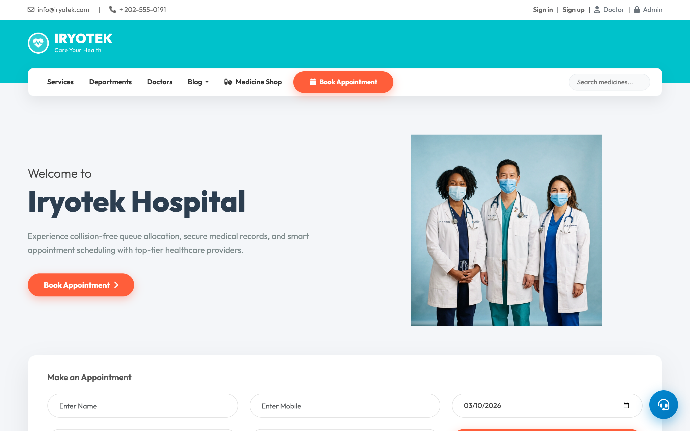
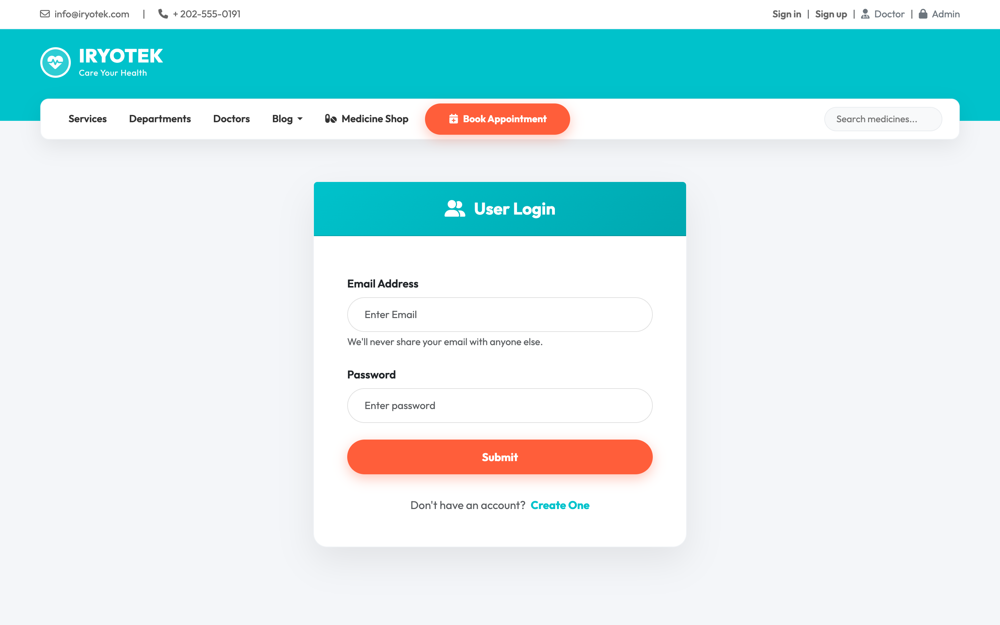
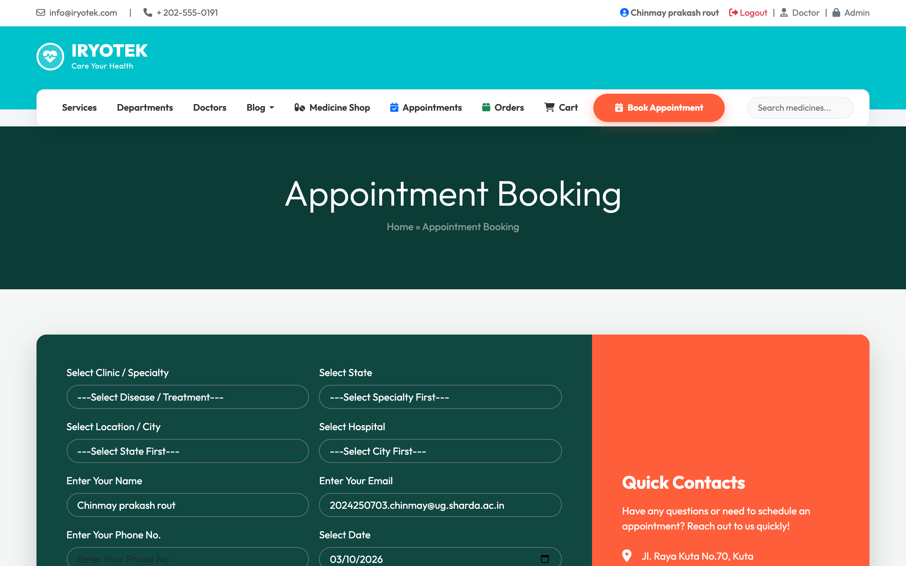
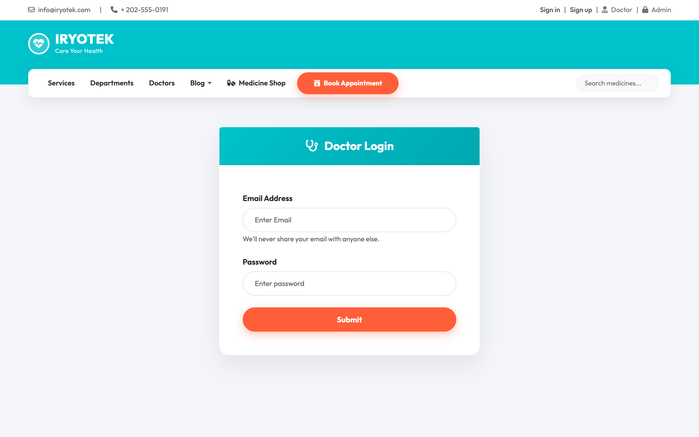
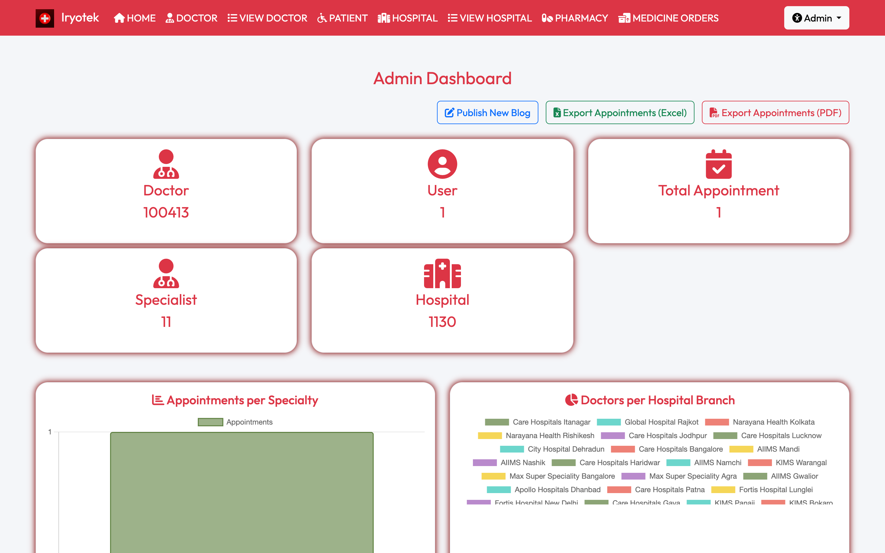
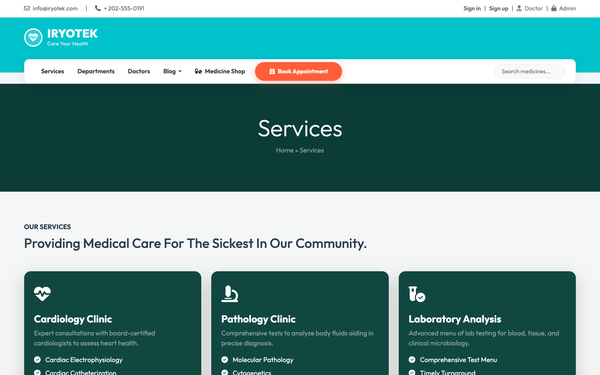

# Iryotek: Hospital Management and Clinic Queue System

Iryotek is a web application for hospital appointments, waiting room queues, patient medical records, and pharmacy ordering. It supports three user roles: patients, doctors, and clinic administrators.

The system connects a Java Servlet 3.1 and JSP backend with a React 19 single-page application (SPA) and server-rendered dashboards.

---

## Technical Documentation

- [Project Architecture Blueprint](file:///Users/chinmayprakashrout/Iryotek-Project/docs/architecture/PROJECT_ARCHITECTURE.md)
- [Repository Audit and Discovery Report](file:///Users/chinmayprakashrout/Iryotek-Project/docs/maintenance/REPOSITORY_AUDIT.md)
- [Target Architecture Specification](file:///Users/chinmayprakashrout/Iryotek-Project/docs/maintenance/TARGET_ARCHITECTURE.md)
- [File Movement and Transformation Manifest](file:///Users/chinmayprakashrout/Iryotek-Project/docs/maintenance/FILE_MANIFEST.md)
- [Cleanup and Restructuring Report](file:///Users/chinmayprakashrout/Iryotek-Project/docs/maintenance/CLEANUP_REPORT.md)

---

## Core Features

* **Appointment Booking**: Patients can filter doctors by department, select an open date, and book a visit.
* **Queue Tokens**: The backend generates sequential token numbers and calculates 15-minute consultation slots starting at 09:00 AM each clinic day.
* **Waiting Room Updates**: WebSockets push live queue status changes to waiting patients as consultations finish.
* **Telehealth Video Consultations**: WebSockets handle signaling for browser-to-browser WebRTC video calls between doctors and patients.
* **Symptom Triage (Gemini API with Offline Heuristics)**: Patients can enter symptoms to receive a preliminary triage level (Green, Yellow, Red) and suggested specialties. If the API is offline or unconfigured, local rules handle the evaluation.
* **Pharmacy Catalog and Cart**: Patients can search medicines, maintain a shopping cart, check out, and download receipt PDFs.
* **Role-Based Portals**: Dedicated, session-gated workspaces for Patients, Doctors, and Administrators.
* **Doctor Records**: Doctors view their daily patient list, record clinical observations, and prescribe medicines.
* **Hospital Administration**: Administrators can manage doctor profiles, departments, hospital branches, and view clinic statistics.

---

## Tech Stack

| Layer | Technology | Purpose |
|---|---|---|
| **Backend Core** | Java 17, Servlet 3.1, JSP, JSTL | Business logic, request handling, and server views |
| **Persistence** | MySQL 8.0, MySQL Connector/J 8.0.33 | Relational database for accounts, visits, and pharmacy data |
| **Security** | jBCrypt 0.4, HTTP Session Filters | BCrypt password hashing and role-based route protection |
| **Real-Time** | JSR-356 Java WebSocket API 1.1 | Queue token broadcasts and WebRTC video signaling |
| **Triage AI** | Google Gemini API (with local rule fallback) | Symptom review and triage suggestions |
| **Frontend** | React 19, TypeScript, TailwindCSS v4, Vite 8 | Patient web portal and interactive landing views |
| **Marketing Site** | Webflow HTML5, CSS3, JavaScript | Static marketing site export |
| **Containers** | Docker, Docker Compose | Multi-stage build and local test environment |

---

## Project Structure

```text
Iryotek-Project/
├── backend/                      # Java Servlet 3.1 and JSP backend (Maven WAR)
│   ├── pom.xml                   # Maven dependencies and build configuration
│   ├── database/                 # Backend SQL schema snapshot
│   └── src/
│       ├── main/
│       │   ├── java/com/hms/     # Servlets, DAOs, models, and utility classes
│       │   ├── resources/        # Classpath configs and templates
│       │   └── webapp/           # JSP templates, stylesheets, scripts, images
│       └── test/java/com/hms/    # Unit tests
├── frontend/                     # React 19 + TypeScript patient client (Vite)
│   ├── package.json              # Client dependencies and npm scripts
│   ├── vite.config.ts            # Proxy and build settings
│   ├── public/                   # Static files
│   └── src/                      # React components, pages, styles
├── legacy-website/               # Static Webflow marketing site export
├── database/                     # Database setup scripts and sample datasets
│   ├── init-scripts/             # MySQL container initialization scripts (run in order)
│   └── dataset/                  # Sample patient data and medicine catalogs
├── docs/                         # Technical documentation and diagrams
│   ├── architecture/             # Architecture specifications and diagrams
│   ├── images/                   # UI screenshots used in this guide
│   └── maintenance/              # Audits, file movement manifests, cleanup logs
├── scripts/                      # Maintenance and utility scripts
├── Dockerfile                    # Multi-stage Docker build (Maven + Tomcat)
├── docker-compose.yml            # Multi-container setup (MySQL 8 + Tomcat 9)
├── .env.example                  # Environment configuration template
├── .editorconfig                 # Code formatting rules
└── README.md
```

---

## System Walkthrough

### Home Landing
The public landing page lists medical specialties, doctor profiles, and portal links.



---

### Patient Workflows
* **Sign In**: Patient authentication portal.  
  

* **Booking a Consultation**: Pick a doctor, choose a date, and reserve a queue slot.  
  

---

### Doctor Dashboard
* **Practitioner Sign In**: Login page for doctors.  
  

---

### Admin Portal
* **Staff Sign In**: Administrative login.  
  

* **Metrics and Overview**: Summary of registered doctors, patients, appointments, and hospital branches.  
  

---

### Hospital Directory
* **Branch Locator**: Hospital branches and affiliated clinics.  
  

---

## Setup and Local Development

### 1. Prerequisites
* **Java Development Kit (JDK)**: Version 17 or higher
* **Apache Maven**: Version 3.8 or higher
* **MySQL Server**: Version 8.0 or higher
* **Node.js**: Version 18 or higher with `npm`
* **Docker and Docker Compose** (optional, for containerized setup)

---

### 2. Environment Configuration
Copy the template file to create your local `.env`:
```bash
cp .env.example .env
```
Default values are configured for local development.

---

### 3. Database Initialization (Manual Setup)
If running MySQL locally without Docker:
1. Log in to MySQL:
   ```bash
   mysql -u root -p
   ```
2. Create the database:
   ```sql
   CREATE DATABASE hospital CHARACTER SET utf8mb4 COLLATE utf8mb4_unicode_ci;
   ```
3. Run the initialization scripts in sequence:
   ```bash
   mysql -u root -p hospital < database/init-scripts/01_schema.sql
   mysql -u root -p hospital < database/init-scripts/02_healthcare_data.sql
   mysql -u root -p hospital < database/init-scripts/03_pharmacy_schema.sql
   mysql -u root -p hospital < database/init-scripts/04_import_medicines.sql
   ```
4. Check your database credentials in `backend/src/main/resources/config.properties`, or export environment variables:
   ```bash
   export DB_URL="jdbc:mysql://localhost:3306/hospital"
   export DB_USER="root"
   export DB_PASSWORD="your_password"
   ```

---

### 4. Build and Run Backend (Maven and Tomcat)

1. Go to the backend folder:
   ```bash
   cd backend
   ```
2. Build the WAR package:
   ```bash
   mvn clean package
   ```
3. Deploy `target/hospital.war` to your Tomcat `webapps/` folder, or run with embedded Jetty:
   ```bash
   mvn jetty:run -Djetty.http.port=8080
   ```
4. Access the backend at:
   ```
   http://localhost:8080/hospital/
   ```

---

### 5. Run Frontend Client (React and Vite)

1. Go to the frontend folder:
   ```bash
   cd frontend
   ```
2. Install dependencies:
   ```bash
   npm install
   ```
3. Start the dev server:
   ```bash
   npm run dev
   ```
4. The client will be available at `http://localhost:8443`.

---

### 6. One-Command Docker Setup

To start both MySQL and the Tomcat application server:
```bash
docker compose up --build
```
MySQL will automatically run the SQL files in `./database/init-scripts/` on first startup.

---

## Troubleshooting

1. **MySQL Connection Errors**:
   - Check that MySQL is running: `brew services status mysql` or `systemctl status mysql`.
   - Verify that the `hospital` database exists and user credentials match `config.properties`.
2. **Port Conflicts**:
   - If port 8080 is already in use, update the port mapping in `docker-compose.yml` or run Jetty on another port (`-Djetty.http.port=8081`).
   - If port 8443 is taken, change `server.port` in `frontend/vite.config.ts`.
3. **Gemini API Not Configured**:
   - The symptom checker uses a local fallback rule set in `GeminiAiUtil.java`. Symptom triage continues to work even without an external API key.

---

## Security Notes

* **Passwords**: User, doctor, and admin passwords use BCrypt hashing (`PasswordUtil.java`).
* **SQL Queries**: Database access uses parameterized `PreparedStatement` queries to prevent SQL injection.
* **Access Control**: Session filters (`AdminFilter.java`, `DoctorFilter.java`) protect admin and doctor routes from unauthenticated requests.
