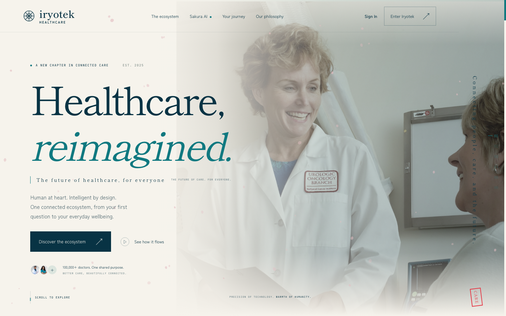
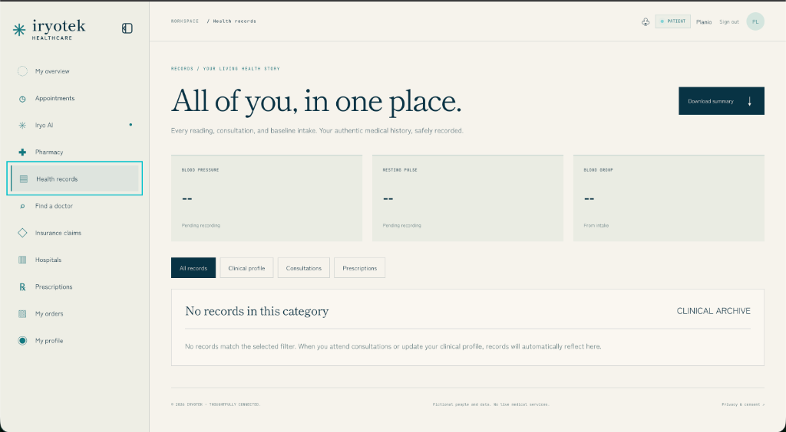
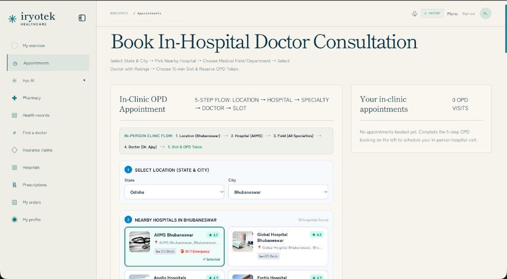
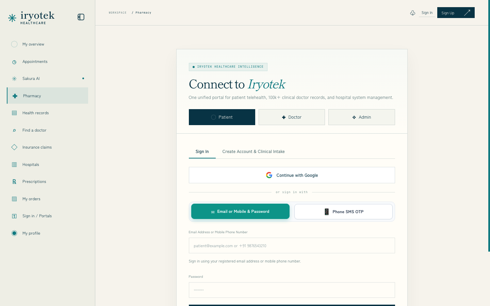

# IRYOTEK : Intelligent Healthcare Management Ecosystem

https://github.com/user-attachments/assets/946ab98b-1787-4d04-9be6-f0e5fb4e7143

<p align="center">
  <strong>Next-Generation Hospital Information System, Clinical Workflow Dispatch, and Patient Care Platform</strong>
</p>

<p align="center">
  
  
  
  
  
  
  
</p>

---

## Overview

Iryotek is a modular healthcare platform connecting patients, clinicians, hospital administrators, and pharmacies in a unified real-time workflow. The platform couples an interactive client application with an enterprise Java servlet backend, supporting hospital appointment routing, clinical emergency triage, e-prescription generation, and medicine catalog inventory.

---

## Live Application Showcase

<table width="100%">
  <tr>
    <td width="50%" align="center">
      
      <br />
      <b>3D Interactive Landing & Experience View</b>
    </td>
    <td width="50%" align="center">
      
      <br />
      <b>My Profile</b>
    </td>
  </tr>
  <tr>
    <td width="50%" align="center">
      
      <br />
      <b>Specialist Booking & Hospital Directory</b>
    </td>
    <td width="50%" align="center">
      
      <br />
      <b>Digital Pharmacy & Prescription Orders</b>
    </td>
  </tr>
</table>

---

## Core Capabilities

* **Doctor & Hospital Scheduling**: Real-time multi-stage appointment dispatching across specialties, hospital departments, and doctor consultation fees.
* **Clinical Triage & Differential Diagnosis**: Clinical symptom analysis engine prioritizing acute emergencies and providing differential diagnosis possibilities.
* **Digital Pharmacy & Prescription Fulfillment**: Searchable medicine inventory with real-time stock levels, dosage guidelines, prescription verification, and cart checkout.
* **Role-Based Authentication**: Dedicated workflows for Patients, Verified Doctors, and Hospital System Administrators with session persistence.
* **Interactive 3D Anatomical Canvas**: Hardware-accelerated interactive anatomical model enabling intuitive visual exploration.

---

## Repository Structure

```text
Iryotek-Project/
├── backend/                      # Java Servlet 3.1 & JSP backend (Maven WAR)
│   ├── pom.xml                   # Maven build configuration and dependencies
│   ├── database/                 # Core SQL schema snapshots
│   └── src/
│       ├── main/
│       │   ├── java/com/hms/     # Servlets, DAOs, models, and utility classes
│       │   ├── resources/        # Classpath configurations and database connection pool
│       │   └── webapp/           # JSP templates, stylesheets, scripts, images
│       └── test/java/com/hms/    # Unit tests
├── frontend/                     # React 19 + TypeScript web application (Vite)
│   ├── package.json              # NPM dependencies and scripts
│   ├── vite.config.ts            # Vite proxy and build settings
│   ├── tsconfig.json             # TypeScript configuration
│   ├── public/                   # Static assets
│   └── src/                      # React views, components, catalog, and API layer
├── animation/                    # Healthcare whiteboard animation video
│   └── animation.mp4             # Explainer animation video
├── database/                     # MySQL setup scripts and seed datasets
│   ├── init-scripts/             # Database initialization schemas (run in sequence)
│   └── dataset/                  # Structured medicine and hospital catalogs
├── docs/                         # Technical documentation and media
│   ├── architecture/             # System diagrams and schema contracts
│   ├── images/                   # UI screenshots and animation assets
│   └── maintenance/              # Repository audit and refactoring history
├── scripts/                      # Platform utility and automation scripts
├── Dockerfile                    # Multi-stage production container build (Maven + Tomcat)
├── docker-compose.yml            # Multi-container orchestration (MySQL 8 + Tomcat 9)
├── .env.example                  # Environment configuration template
└── README.md
```

---

## Getting Started

### Prerequisites

* **Node.js**: 20+ (with npm or pnpm)
* **Java Development Kit**: JDK 8, 11, or 17
* **Apache Maven**: 3.8+
* **Docker & Docker Compose** (Optional, for containerized run)

### 1. Running via Docker Compose

To start the database, Java backend, and Tomcat container in one command:

```bash
docker compose up -d
```

### 2. Manual Development Setup

#### Frontend (React + Vite)

```bash
cd frontend
npm install
npm run dev
```

The frontend will be available at `http://localhost:8443` (or port `5173`).

#### Backend (Java + Tomcat)

```bash
cd backend
mvn clean package
```

Deploy the generated `target/Iryotek.war` to your local Apache Tomcat `webapps/` folder, or run with embedded Tomcat.

---

## Healthcare Whiteboard Animation

The project includes an explainer animation video showcasing the Iryotek connected healthcare experience:

* Video: [`animation/animation.mp4`](animation/animation.mp4)

---

## Build Verification

* **Frontend TypeScript**: `cd frontend && npx tsc --noEmit` exits with `0` (Zero compiler errors).
* **Vite Production Build**: `cd frontend && npm run build` compiles `dist/` in under 1 second.
* **Java Backend**: `cd backend && mvn clean compile` successfully compiles all 89 enterprise source files.

---

## License

This project is licensed under the Apache License 2.0.
