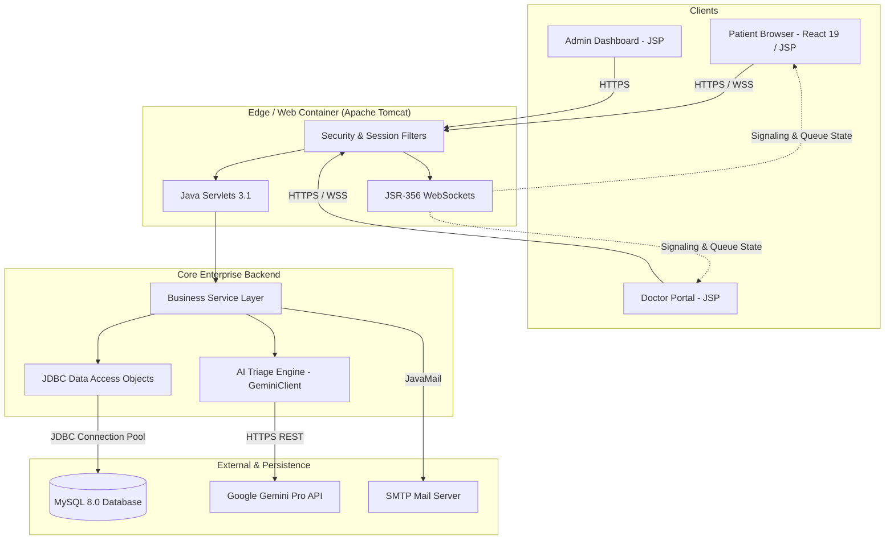
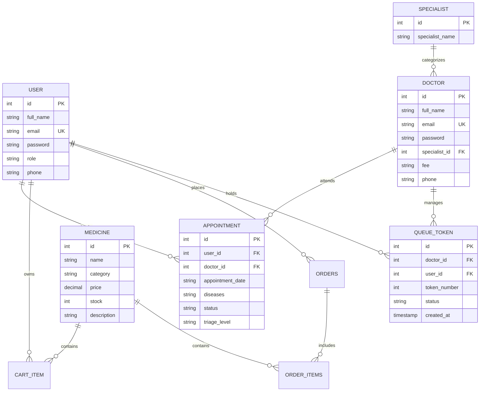

# Iryotek: System Architecture Blueprint

**Version**: 2.0 (Production Reference)  
**Classification**: Enterprise Technical Architecture  
**Author**: Principal Software Architect & Senior Java Enterprise Engineer  

---

## 1. Executive Architecture Summary

Iryotek is an enterprise-grade AI-powered healthcare management platform engineered with a hybrid architecture:
1. **Core Enterprise Engine**: A high-throughput Java Servlet 3.1 & JSP backend providing secure electronic health records (EHR), multi-role clinical administration, appointment dispatch, queue token distribution, and pharmacy point-of-sale fulfillment.
2. **Modern Clinical & Patient SPA**: A dynamic React 19 + TypeScript frontend built on Vite 8 and TailwindCSS v4 with hardware-accelerated 3D WebGL anatomical models for interactive patient onboarding.
3. **Cognitive AI Layer**: Google Gemini Pro integration providing automated clinical triage, symptom extraction, emergency categorization (GREEN / YELLOW / RED), and heuristic offline fallbacks.
4. **Real-Time Communication Matrix**: Low-latency JSR-356 WebSockets orchestrating live outpatient waiting room queues and WebRTC video consultation signaling.
5. **Relational Data Fabric**: MySQL 8.0 with InnoDB ACID persistence, parameterized JDBC connection handling, and automated containerized initialization.

---

## 2. Layered Backend Architecture

### 2.1 Presentation & View Layer
- **JSP & JSTL (JavaServer Pages Standard Tag Library)**:
  - Role-segregated view modules:
    - `backend/src/main/webapp/*.jsp`: Public landing, patient login, registration, appointment booking, pharmacy shop, and appointment history.
    - `backend/src/main/webapp/doctor/*.jsp`: Physician consultation dashboard, active patient roster, clinical prescription notes, and appointment acceptance workflows.
    - `backend/src/main/webapp/admin/*.jsp`: Hospital oversight, specialist onboarding, physician credentialing, and system metrics.
    - `backend/src/main/webapp/component/*.jsp`: Reusable UI navigation bars (`navbar.jsp`), stylesheets (`allcss.jsp`), and footers (`footer.jsp`).
- **Dynamic JavaScript Dock & UI**:
  - `backend/src/main/webapp/js/`: Client-side validation, appointment date constraints, interactive shopping cart counters, and dynamic doctor availability filtering.

### 2.2 Controller Layer (Java Servlets)
The controller layer consists of 36 dedicated servlets mapped in `backend/src/main/webapp/WEB-INF/web.xml`:
- **User & Patient Servlets (`com.hms.user.servlet`)**:
  - `UserRegisterServlet`, `UserLoginServlet`, `UserLogoutServlet`, `ChangePasswordServlet`.
  - `AppointmentServlet`: Validates doctor schedule conflicts, assigns initial queue tokens, and logs consultation records.
  - `CartServlet`, `AddToCartServlet`, `RemoveCartServlet`, `CheckoutServlet`: Pharmacy ecommerce transactions.
  - `SymptomCheckerServlet`: Interfaces with the AI triage engine to evaluate patient self-reported symptoms.
- **Doctor Servlets (`com.hms.doctor.servlet`)**:
  - `DoctorLoginServlet`, `DoctorLogoutServlet`, `DoctorEditProfileServlet`, `DoctorChangePasswordServlet`.
  - `UpdateStatusServlet`: Updates clinical appointment progression (PENDING -> CONFIRMED -> COMPLETED / CANCELLED).
- **Admin Servlets (`com.hms.admin.servlet`)**:
  - `AdminLoginServlet`, `AdminLogoutServlet`.
  - `DoctorServlet`, `UpdateDoctorServlet`, `DeleteDoctorServlet`: Doctor lifecycle management.
  - `SpecialistServlet`: Manages medical departments (Cardiology, Dermatology, Neurology, Oncology, etc.).

### 2.3 Business Service & Domain Layer
- **`com.hms.service`**:
  - `QueueService`: Manages doctor consultation waiting rooms, computes estimated wait times based on specialty averages, and triggers real-time WebSocket notifications.
  - `TriageService`: Coordinates with `GeminiAiUtil` to rate symptom severity and route emergency cases.
- **`com.hms.entity` & `com.hms.model`**:
  - Plain Old Java Objects (POJOs) representing domain records: `User`, `Doctor`, `Appointment`, `Specialist`, `Medicine`, `CartItem`, `Order`, `QueueToken`.

### 2.4 Data Access Layer (DAO)
- Direct JDBC communication with prepared statements preventing SQL injection attacks:
  - `UserDAO`: Encapsulates user retrieval and credential checking.
  - `DoctorDAO`: Queries physician capacity, specialization filtering, and credentials.
  - `AppointmentDAO`: Atomically books appointments, checks slot exclusivity, and retrieves patient history.
  - `MedicineDAO`: Manages inventory levels, tracks product pricing, and checks prescription requirements.
  - `CartDAO` & `OrderDAO`: Persists patient pharmacy carts and completed order receipts.
  - `QueueDAO`: Tracks real-time token states (WAITING, IN_CONSULTATION, COMPLETED).

---

## 3. Real-Time Communication Layer (WebSockets)

Iryotek utilizes Java standard JSR-356 WebSocket endpoints to deliver instantaneous, bidirectional updates without client-side polling overhead:

1. **Live Waiting Room Queue (`QueueWebSocketServer.java`)**:
   - Endpoint: `/ws/queue/{doctorId}`
   - Purpose: When a doctor completes or advances a consultation, the server pushes updated queue positions and estimated wait times to all connected patients in that doctor's virtual waiting room.
   - Message Protocol: JSON payloads containing `{ "type": "QUEUE_UPDATE", "tokenNumber": 4, "currentServing": 2, "estimatedWaitMinutes": 15 }`.
2. **Telehealth WebRTC Video Consultation (`VideoConsultationWebSocketServer.java`)**:
   - Endpoint: `/ws/video/{appointmentId}`
   - Purpose: Serves as the signaling plane for browser-to-browser peer-to-peer WebRTC video consultations between doctors and patients.
   - Message Protocol: Facilitates exchange of WebRTC Session Description Protocol (SDP) offers, answers, and Interactive Connectivity Establishment (ICE) candidates.

---

## 4. Artificial Intelligence & Triage Engine

The AI integration resides under `com.hms.ai`:

1. **Google Gemini Client (`GeminiClient.java`)**:
   - Communicates with Google's Gemini Pro endpoint via secure HTTPS REST calls.
   - Accepts patient-submitted natural language symptom descriptions, medical history, age, and vital indicators.
2. **Clinical Triage Processing (`GeminiAiUtil.java`)**:
   - Prompt engineering instructs Gemini to act as a clinical triage nurse:
     - Extracts primary symptoms, probable condition categories, and urgency level.
     - Assigns a triage category:
       - **GREEN**: Non-urgent; recommend standard outpatient clinic booking.
       - **YELLOW**: Moderate urgency; prioritize in upcoming queue.
       - **RED**: Critical emergency; advises immediate emergency room referral or 911 dispatch.
3. **High-Availability Offline Fallback**:
   - In the event of network disconnection, rate limiting, or API key exhaustion, `GeminiAiUtil` executes a deterministic local rule-based heuristic matrix to guarantee the triage workflow never fails or hangs a user session.

---

## 5. Security & Identity Architecture

1. **Authentication & Session Management**:
   - Password Hashing: BCrypt encryption via `jBCrypt` with standard 10 salt rounds. Plaintext passwords are never stored in the database.
   - Session Tokens: Standard HTTP session cookies with `HttpOnly` and `SameSite` flags.
   - Role Isolation: Distinct session tokens (`userObj`, `doctObj`, `adminObj`) prevent privilege escalation across user tiers.
2. **Access Control Filters**:
   - `AdminFilter`: Restricts access to `/admin/*` views and admin servlets to authenticated administrators.
   - `DoctorFilter`: Protects clinical records and physician consultation tools in `/doctor/*`.
3. **Input Sanitization & Injection Defense**:
   - All database operations utilize JDBC `PreparedStatement` with typed parameter binding, eliminating SQL injection vulnerabilities.
   - HTML form submissions are validated for cross-site scripting (XSS) attack vectors before rendering.

---

## 6. Database Architecture & Schemas

The application connects to MySQL 8.0 (`hospital` database) configured in `database/init-scripts/`:

---

## 7. Containerization & Deployment Model

1. **Multi-Stage `Dockerfile`**:
   - **Stage 1 (Builder)**: `maven:3.9-eclipse-temurin-17-alpine` compiles `backend/pom.xml` into `hospital.war`.
   - **Stage 2 (Runtime)**: `tomcat:9.0-jdk17-temurin-alpine` deploys `hospital.war` into Tomcat `webapps/ROOT/`.
2. **Local Orchestration (`docker-compose.yml`)**:
   - Spins up both `mysql:8.0` (with persistent volume and automatic schema ingestion via `./database/init-scripts`) and the Tomcat web container.
   - Enables one-command development: `docker compose up --build`.
